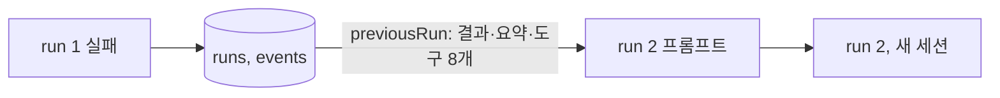

# akbun-taskq 0.35.0 학습 노트

연결 페이지 두 기능을 만들던 중에 사용자가 직접 실행이 안 된다고 알려 왔고, 그 원인을 따라가면서 작업 실행과 상세 화면을 함께 고쳤다.

## 실행이 매번 실패한 이유

사용자 컴퓨터의 run 기록을 읽어 보니 실행은 12초 만에 "worker returned no valid structured result"로 끝났고, 이벤트에는 `StructuredOutput` 호출이 두 번 있었다. worker는 `Options.outputFormat`(json_schema)으로 결과를 받는데, SDK는 그 결과를 `StructuredOutput`이라는 도구 호출로 돌려준다. 작업 게이트(`decide`)는 작업 유형마다 허용한 도구 목록만 통과시켜서 이 도구를 거부했고, 결과가 없으니 모든 run이 실패했다. 결과 도구는 아무것도 건드리지 않으므로 모든 유형에서 맨 먼저 허용한다.

## task와 세션을 떼어 놓는다

재시도의 "이전 세션 이어서"와 실행 기록의 `claude --resume`은 task가 세션을 가진다는 전제였다. 하지만 세션은 그 task를 돌린 쪽의 것이고, bot의 세션은 다른 일로 계속 이어진다. 그래서 재시도는 늘 새 세션으로 하고, 대신 직전 run의 결과·요약·마지막 도구 호출 8개를 새 프롬프트에 "이미 한 일"로 넣는다. 결정은 [knowledge](../../knowledge/decisions/2026-11-task-not-tied-to-session.md)에 남겼다.

## 연결 페이지

TLS 검사 인증서는 `TASKQ_HOME/taskq-ca-bundle.pem`에 두고 `config.caBundle`이 된다. Claude 세션은 `buildEnv`로, kiro-cli·codex·aws CLI 같은 다른 자식은 taskq 자신의 환경 변수(`NODE_EXTRA_CA_CERTS`, `AWS_CA_BUNDLE`)로, taskq가 직접 하는 요청은 `tls.setDefaultCACertificates`로 받는다. 데이터 폴더에 두지 않은 것은 sandbox를 켠 bot의 aws CLI도 읽어야 하기 때문이고, 대신 bot이 그 파일을 건드리면 `taskq.config.json`처럼 turn을 멈춘다.

Kiro 연결은 meta의 JSON 목록과 사용 중인 id로 바꿨다. 로그인과 연결 테스트가 쓰는 `kiroSso()`가 사용 중인 연결을 돌려주므로 호출하는 쪽은 바뀌지 않았다. 예전 home의 start URL 하나는 첫 연결로 읽힌다.

## 카드 끌기

데모에서는 합성 이벤트로 확인해서 놓쳤다. WebKit은 draggable 부모 안의 `<button>`에서 끌기를 시작하지 않는다. 카드 대부분이 버튼이라 데스크톱 앱에서는 끌기가 시작되지 않았다. 버튼 자체에 `draggable`과 `-webkit-user-drag: element`를 주고, 이벤트는 li가 버블링으로 받는다. Tauri의 파일 드롭 처리기도 페이지의 끌기 이벤트를 가로챌 수 있어 `disable_drag_drop_handler()`로 껐는데, 이것은 껍데기 수정이라 새 dmg부터 적용된다.
