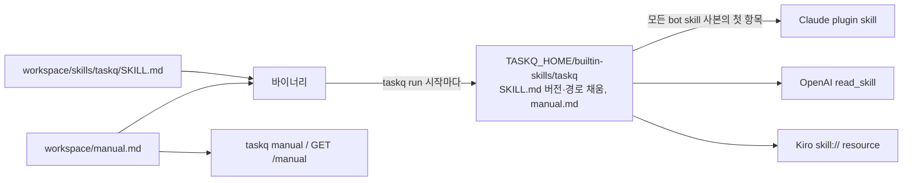

# akbun-taskq 0.36.0 학습 노트

bot은 지금까지 자기가 어떤 프로그램 안에서 도는지 몰랐다. 사용자가 taskq 기능을 물으면 오래된 기억이나 추측으로 답했고, 워크플로는 사람만 화면에서 만들 수 있었다. 이번 버전은 bot이 자기 환경을 알도록 기본 skill을 더했다.

## 구조

- 원본은 product 안의 두 파일이다. `build-binary.ts`가 `skills/`와 `manual.md`를 바이너리에 싣고, `installBuiltinSkill()`이 시작할 때 `{{version}}`, `{{home}}`, `{{manual}}`을 채워 TASKQ_HOME에 쓴다.
- bot의 skill 사본을 만드는 `reload()`가 등록 목록과 상관없이 맨 먼저 이 폴더를 복사한다. 그래서 skill을 하나도 등록하지 않은 bot도 skill 폴더를 받는다(`pluginPaths`가 항상 그 폴더를 넘긴다). 시작할 때 모든 bot을 다시 불러와 이전 버전 사본이 남지 않게 했다.
- 등록 목록 밖이라 Plugins의 삭제·업데이트 버튼이 닿지 않는다. 같은 이름의 등록은 `registerEntry`가 거부한다.

## 매뉴얼을 본문에 넣지 않은 이유

skill 본문은 매 turn bot의 context에 들어갈 수 있다. 매뉴얼 370줄을 넣으면 그만큼 늘어난다. 본문에는 무엇이 어디 있는지만 두고, bot이 필요한 절을 파일에서 읽게 했다. 같은 파일을 사람(`taskq manual`)과 프로그램(`GET /manual`)이 읽는다.

## 워크플로 도구

bot은 데이터 보호 때문에 `taskq` CLI를 실행할 수 없다. 그래서 CLI의 `workflows create`가 하는 일을 `create_workflow`/`update_workflow` 도구로 줬다. 검사는 API와 같은 `parseDefinition`이 한다.
