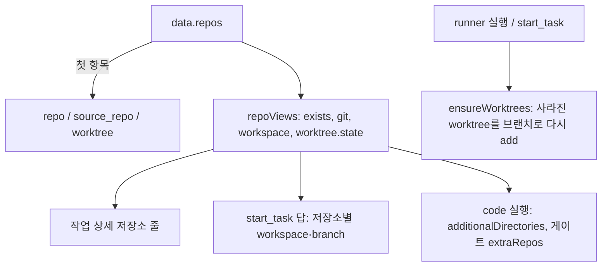

# akbun-taskq 0.37.0 학습 노트

task는 지금까지 저장소를 하나(`data.repo`)만 가졌고, code 작업이면 만들 때 worktree를 하나 만들었다. 실제 일은 API와 웹처럼 저장소 여러 개에 걸치는 경우가 많고, worktree는 정리 프로그램이 지우면 task가 사라진 경로를 가리킨 채 남았다.

## 데이터

`data.repos: [{ source, worktree }]`를 더하고, 첫 항목을 기존 필드(`repo`, `source_repo`, `worktree`, `base_commit`)로 그대로 비춘다. worker, 게이트, 보안 리뷰는 기존 필드를 읽으므로 손대지 않았다. 예전 task는 기존 필드에서 목록 하나를 만들어 읽는다(`reposOf`).

## 사라진 worktree

worktree를 지워도 브랜치(`taskq/<task>`)는 남는다. 그래서 다시 만들 때는 `git worktree prune` 뒤 `git worktree add <path> <branch>`로 같은 경로에 같은 브랜치를 붙인다. 브랜치까지 없으면 기록해 둔 base에서 새로 만든다. runner는 세션을 시작하기 전에, bot은 `start_task`에서 이 일을 한다. 화면은 폴더가 있는지만 보고 "사라짐"을 표시한다.

## 여러 저장소와 권한

code 실행은 첫 저장소를 cwd로 두고 나머지 작업 폴더를 `additionalDirectories`와 sandbox 쓰기 허용에 넣는다. 작업 게이트의 code 정책도 그 폴더들(`extraRepos`)에 읽기·쓰기를 허용한다. 같은 이름의 저장소 두 개는 worktree 경로 뒤에 순번을 붙여 겹치지 않게 했다.
