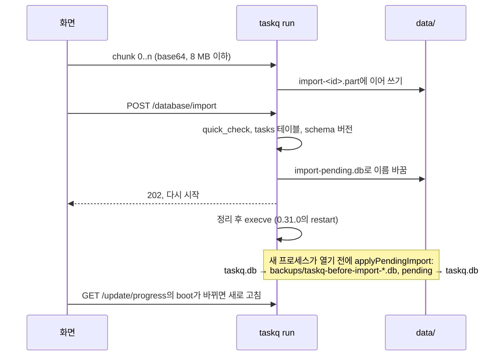

# akbun-taskq 0.38.0 학습 노트

SQLite 파일 하나가 taskq의 전부인데, 그 파일을 안전하게 꺼내고 되돌리는 길이 없었다. 실행 중인 데이터베이스를 그냥 복사하면 WAL에 남은 쓰기가 빠질 수 있고, 실행 중에 파일을 바꿔 끼우면 열린 연결이 깨진다.

## 백업

`VACUUM INTO`는 열린 연결에서 일관된 사본을 새 파일로 만든다. 사본은 `data/backups`에 둔다. 공용 폴더에 두면 bot이 승인 입력까지 담긴 데이터베이스를 읽을 수 있기 때문이다. 화면은 토큰이 필요한 `GET /database/backups/:name`으로 받아 blob으로 저장한다.

## 복원

- API는 CSRF 방어로 JSON 요청만 받는다. 그래서 파일을 base64 조각으로 순서대로 올린다.
- 교체는 서버가 데이터베이스를 열기 전에만 안전하다. 그래서 `main.ts`가 `run`일 때 `openDb` 전에 `applyPendingImport`를 부른다. CLI나 MCP 프로세스는 교체하지 않는다.
- 다시 시작은 0.31.0의 `relaunch`(같은 pid, 같은 토큰)를 그대로 쓴다. 이전 데이터베이스는 `-wal`, `-shm`과 함께 옮겨 남긴다.

## 리뷰에서 고친 것

- 복원에는 설치 단계가 없어서 "진행 상태가 idle이면 새 프로세스"라는 업데이트의 판단이 통하지 않았다. 옛 프로세스도 처음부터 idle이기 때문이다. execve라 pid도 같으므로, 프로세스마다 무작위 `boot` id를 진행 상태에 넣고 페이지는 그 값이 바뀌면 새로 고친다. 업데이트 후 다시 시작도 같은 방식으로 바꿨다.
- 조각은 `offset`이 지금까지 받은 크기와 같아야 붙는다. 같은 조각이 두 번 와도 파일이 망가지지 않는다.
- 검사하려고 연 파일 옆에 SQLite가 만든 `-wal`, `-shm`은 지운다. 바꿔 끼운 파일이 열리지 않거나 마이그레이션에 실패하면 이전 데이터베이스를 되돌려 다음에도 taskq가 뜨게 했다.
