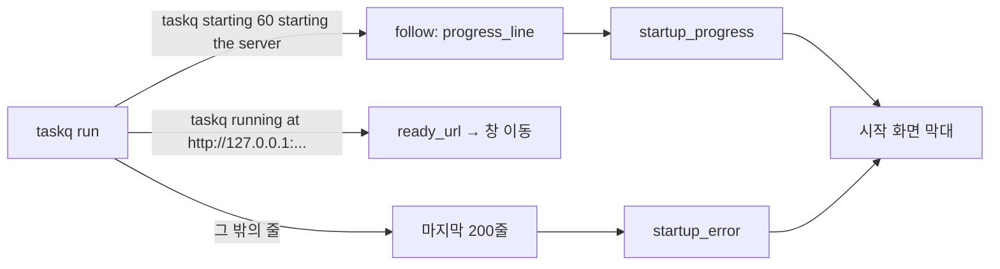

# akbun-taskq 0.39.0 학습 노트

데스크톱 앱은 taskq 실행 파일을 띄우고 그 출력에서 주소 줄을 기다린다. 그동안 시작 화면은 "Starting taskq…" 한 줄뿐이었고, 실패하면 출력 20줄을 작은 글씨로 보였다.

## 진행률은 taskq가 말한다

껍데기는 taskq 안에서 무슨 일이 일어나는지 모른다. 그래서 taskq가 단계마다 `taskq starting <퍼센트> <단계>` 줄을 출력하고, 껍데기의 `follow()`가 주소 줄을 찾던 같은 반복에서 이 줄도 읽어 상태에 둔다. 시작 화면은 `startup_progress` 명령을 0.3초마다 불러 막대를 그린다. 줄을 읽는 규칙은 Tauri 없이 테스트하는 `taskq_launch::progress_line`에 두었다.

퍼센트는 실제 소요 시간 비율이 아니라 단계의 순서다. bot이 많으면 85%(bot 불러오기)에서 오래 머문다.

## 실패 로그

남기는 줄을 20줄에서 200줄로 늘리고 `<pre><code>`로 보인다. 복사는 `navigator.clipboard`를 쓰고, 막히면 로그를 선택해 두어 Cmd+C로 복사하게 했다.
