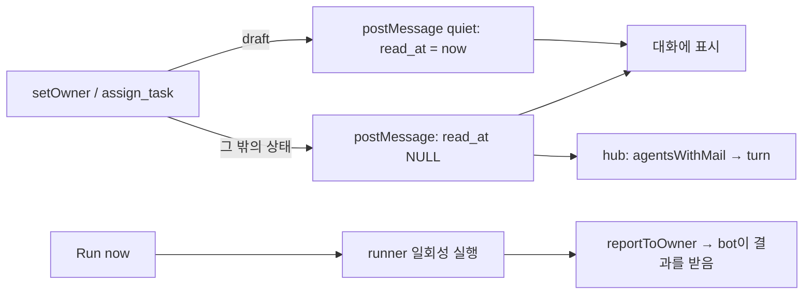

# akbun-taskq 0.40.0 학습 노트

## 초안 할당은 bot을 깨우지 않는다

bot은 mailbox에 읽지 않은 메시지가 생기면 turn을 연다. `setOwner`는 owner를 바꿀 때마다 "Task … is now yours"를 보냈기 때문에, 초안에 bot을 정하는 순간 bot이 깨어나 `start_task`를 시도했고 draft라서 거절당한 채 사용자에게 되물었다.

알림을 없애면 bot 대화에 할당 기록이 남지 않는다. 그래서 메시지는 그대로 쓰되 처음부터 읽은 상태로 저장했다. `postMessage`에 `quiet` 옵션을 더해 `read_at`을 생성 시각으로 넣고, `agentsWithMail`은 `read_at IS NULL`만 보므로 turn이 열리지 않는다. 대화 화면은 `read_at`과 관계없이 메시지를 모두 그리므로 알림이 보인다. 모델 변경 메모가 따로 하던 `UPDATE … SET read_at`도 이 옵션으로 바꿨다.

bot끼리 넘기는 `assign_task`와 다른 bot에게 만들어 주는 `create_task`도 같은 규칙을 따른다. 판단 기준은 할당 시점의 task 상태 하나다.

조용히 알리기만 하면 빈틈이 하나 생긴다. 큐는 owner가 있는 task를 자동 실행하지 않으므로, 초안을 대기로 올린 task는 아무도 깨우지 않아 영원히 대기에 남는다. 그래서 `PATCH /tasks/:id`의 draft→ready 이동에서 owner가 있으면 `notifyOwner`로 읽지 않은 알림을 다시 보낸다. 초안 동안의 할당은 기록이고, 대기로 올리는 것이 일을 시작하라는 신호다.

## 상태보드 대기 열

`BOARD_PANES.flow`는 작업 상세의 단계 표시가 쓰고 있어 그대로 두고, 보드만 `BOARD_WAITING` 목록으로 대기 상태들을 한 열에 모았다. 대기 열의 `data-column`은 `ready`라서 끌어다 놓기는 `dropRequest(task, 'ready')`, 곧 대기열로 보내기가 된다. 열별 테두리 색(`--bar`)은 지웠다. 카드 색이 상태를 말하면 한 열에 여러 상태가 섞이는 대기 열에서 오히려 읽기 어렵고, 상태는 열 제목과 카드의 상태 표시가 이미 말한다.

## 대화 화면

- 작업 중 바는 `.chat`의 `--gutter`를 padding이 아니라 margin으로 써서 배경까지 대화 열 안에 들어온다.
- 입력 기록은 이미 불러온 대화에서 사용자가 이 bot에게 보낸 말을 뽑아 쓴다. 서버에 따로 저장하지 않는다. ↑는 커서가 첫 줄에 있을 때만 기록으로 넘어가 여러 줄 편집을 방해하지 않고, 슬래시 목록이 열려 있으면 그 목록이 먼저 키를 가져간다(`defaultPrevented`).
- 오른쪽 열은 `.chat-page` grid의 세 번째 칸이다. 전에는 파일 창이 열리면 숨었는데, 이제 1200px보다 넓으면 `대화 | 창 | 컨텍스트`로 놓인다. DOM 순서가 이미 그 순서라 grid 열 정의만 바꿨다.
